# CA-72 quick start

Your first half hour with the CA-72 0.3. The pictures are the editor's own frames in the
default realistic look; click one to see it larger. For every control in detail, see the
README's [Instrument controls](../README.md#instrument-controls).

- [1. Install, rescan and open](#1-install-rescan-and-open)
- [2. The panel at a glance](#2-the-panel-at-a-glance)
- [3. A first sound in under a minute](#3-a-first-sound-in-under-a-minute)
- [4. Vibrato and modulation, step by step](#4-vibrato-and-modulation-step-by-step)
- [5. Vibrato from the LFO page](#5-vibrato-from-the-lfo-page)
- [6. MONO, POLY and UNISON](#6-mono-poly-and-unison)
- [7. QUALITY: LO, HI and ULTRA](#7-quality-lo-hi-and-ultra)
- [8. Gain headroom: DRIVE, AUTO GAIN and OVERLOAD](#8-gain-headroom-drive-auto-gain-and-overload)
- [9. Presets: find, save, start again](#9-presets-find-save-start-again)
- [10. MIDI Learn](#10-midi-learn)
- [11. The standalone's MIDI map mode](#11-the-standalones-midi-map-mode)
- [12. The ARP and FX drawers](#12-the-arp-and-fx-drawers)
- [Troubleshooting](#troubleshooting)

## 1. Install, rescan and open

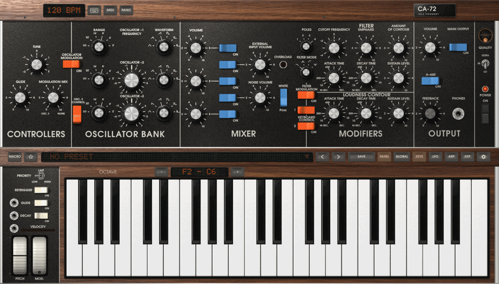

Download the installer for your computer from the
[latest release](https://github.com/idlefoundry/ca-72/releases/latest), then:

- **macOS 11 or later:** run `CA-72-<version>-macOS.pkg` (signed and notarised). It installs
  the VST3, CLAP and Audio Unit in `/Library/Audio/Plug-Ins/` and the app in `/Applications`.
- **Windows 10 or 11, 64-bit:** run `CA-72-<version>-Windows-setup.exe`. It is not yet signed:
  when Windows says "Windows protected your PC", click **More info**, then **Run anyway**. The
  VST3 and CLAP go into `C:\Program Files\Common Files\VST3` and `…\CLAP`.
- **Linux, x86-64:** unpack `CA-72-<version>-Linux-x86_64.tar.gz` and run `./install.sh` in
  its folder. The VST3 goes into `~/.vst3` and the CLAP into `~/.clap` (`./install.sh
  --system` uses `/usr/lib/vst3` and `/usr/lib/clap`).

Then **rescan** your host's plug-ins, or restart it, and add the CA-72 as an instrument by
Idle Foundry. Where your host keeps its rescan depends on the host; for example:

- **Logic Pro and GarageBand:** look under **AU Instruments › Idle Foundry**. If it is missing,
  open Logic's **Plug-in Manager** and rescan the CA-72.
- **Ableton Live:** **Settings › Plug-Ins**: turn on the system VST3 folder, then **Rescan**.
- **REAPER:** **Options › Preferences › Plug-ins › VST**: **Re-scan**.

There is no AAX version, so Pro Tools cannot load it.

**The standalone** is the same instrument as a desktop app: `/Applications/CA-72.app` on macOS,
**CA-72** in the Start menu on Windows, its desktop entry or `ca72-standalone` on Linux. Open
the settings gear at the rail's right end, choose **AUDIO & MIDI**, pick your output, buffer
size and MIDI input, then **Apply**. No MIDI keyboard? Click the keys, or press the
keyboard-picture key (**TYPING**) beside the TEMPO screen and play from your computer: `A` is
C, `W` is C-sharp, `S` is D; `Z` and `X` shift the octave.

To update, open the presets' drawer and click **[ CHECK FOR UPDATES ]**. The README's
[Installing](../README.md#installing) has the uninstall steps and the choice of folder or
external drive.

## 2. The panel at a glance

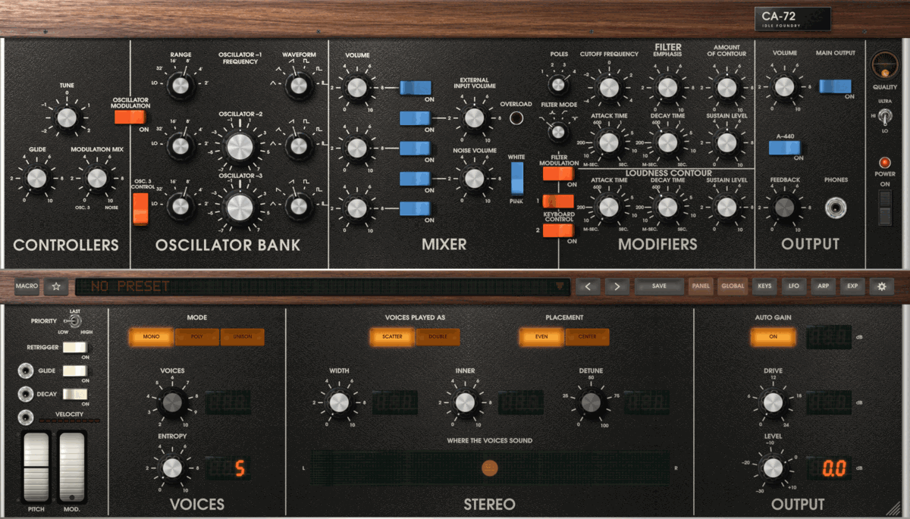

The upper panel reads as the instrument does, left to right: **CONTROLLERS** (tune, glide
and modulation), **OSCILLATOR BANK** (the three oscillators), **MIXER** (which sources are
heard, and how loud), **MODIFIERS** (the filter and the two contours) and **OUTPUT**.
QUALITY and POWER sit at the far right.

In MODIFIERS, **POLES** selects one to four filter poles; **FILTER MODE** below it selects
LO, BAND, STEEP HIGH or NOTCH using pictures of their responses. Start with four poles
and LO for the original low-pass sound.

The wooden rail under it holds **MACRO**, the favourite star, the preset's name (click it for
the presets), the previous and next arrows, **SAVE**, then the lower area's keys: **PANEL**
shows or hides it; **GLOBAL** (VOICES, STEREO and OUTPUT), **KEYS** (a playable keyboard) and
**LFO** choose its page; **ARP**, **EXP** and, in the standalone, **FX** drop drawers over it;
the gear opens settings. The wheels, PRIORITY, RETRIGGER, GLIDE and DECAY stay at the left.

Drag knobs up or down, or scroll them; hold Shift for fine changes; double-click for the
default. Point at a control to see its name and value. If the print is small, choose
**LETTERING › LARGE** in settings.

## 3. A first sound in under a minute

1. Click the preset's name under the panel, then **INIT** at the drawer's top right, and close
   the drawer (**CLOSE**, or Escape). Init is oscillator 1 alone: a sawtooth at **8′**, in MONO.
2. Play a note. Nothing? See [No sound](#troubleshooting).
3. In **OSCILLATOR BANK**, turn oscillator 1's **WAVEFORM** and **RANGE**. In **MIXER**, switch
   on the second oscillator's **ON** and set the two **VOLUME** knobs.
4. In **MODIFIERS**, lower **CUTOFF FREQUENCY** for a darker tone; add **EMPHASIS** for
   resonance and **AMOUNT OF CONTOUR** for the filter's sweep on each note.
5. Shape the note with **LOUDNESS CONTOUR**'s ATTACK TIME, DECAY TIME and SUSTAIN LEVEL. The
   **DECAY** switch at the left lets the contours fade after you let go.

Save anything you want to keep first (section 9): INIT replaces the current sound.

## 4. Vibrato and modulation, step by step

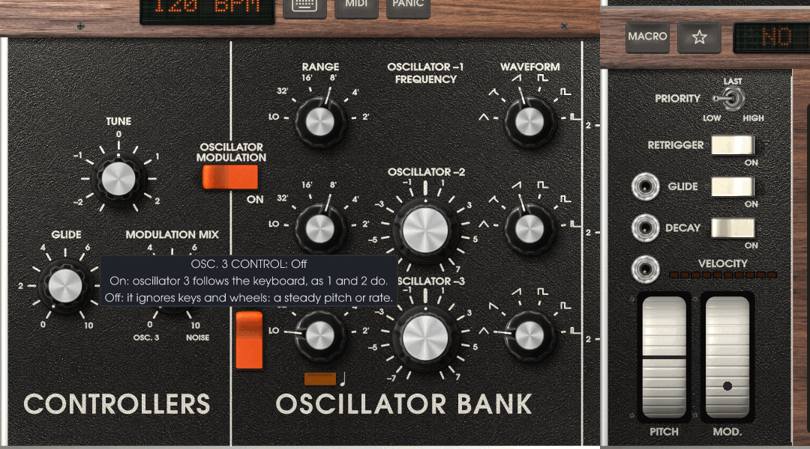

The panel has no separate LFO section: as on the instrument, **oscillator 3** turned slow is
the modulation source. From Init:

1. **Make oscillator 3 slow.** Set its **RANGE** to **LO** and its **WAVEFORM** to the
   triangle (the first position).
2. **Free it from the keys.** Turn **OSC. 3 CONTROL** off, so that oscillator 3 keeps its rate
   whatever you play. Its **FREQUENCY** knob is now the vibrato's rate.
3. **Leave it out of the mixer.** Oscillator 3's mixer switch can stay off: it modulates
   without being heard.
4. **Choose the source.** Turn **MODULATION MIX** fully counterclockwise, to **OSC. 3**.
5. **Choose where it goes.** Turn **OSCILLATOR MODULATION** on for pitch (vibrato), or
   **FILTER MODULATION** for the filter's cutoff (a wah), or both.
6. **Raise the MOD. wheel** at the left, on screen or on your controller. Nothing is modulated
   with the wheel at 0.

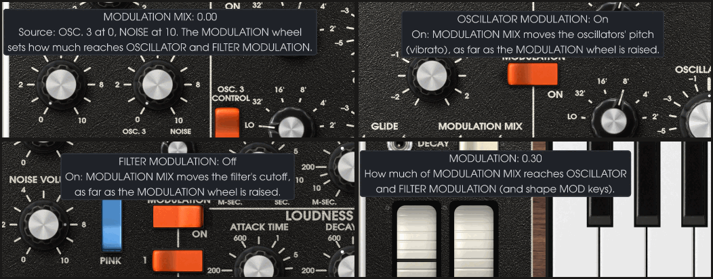

Point at any of these controls to see its part of the route. **MODULATION MIX** blends
oscillator 3 (at 0) with **noise** (at 10); toward NOISE the modulation turns random, even
with the mixer's NOISE switch off. The **filter's contour** is separate: AMOUNT OF CONTOUR
sweeps the cutoff on every note without the wheel or FILTER MODULATION.

More from the same route:

- **Tempo-synced modulation:** with oscillator 3 at LO, press the small amber key under its
  RANGE; its FREQUENCY then reads note values locked to the host's tempo (the standalone's
  TEMPO). OSC. 3 CONTROL does nothing while it is timed.
- **Vibrato from pressure or a pedal:** settings' **MOD WHEEL SOURCE** chooses what moves the
  wheel: CC 1 (the default), another CC such as breath (2) or expression (11), channel
  aftertouch, or polyphonic aftertouch. It is this computer's choice, not the preset's. The
  wheel follows whichever is higher, the screen's or MIDI's: to stop the modulation, lower both.

## 5. Vibrato from the LFO page

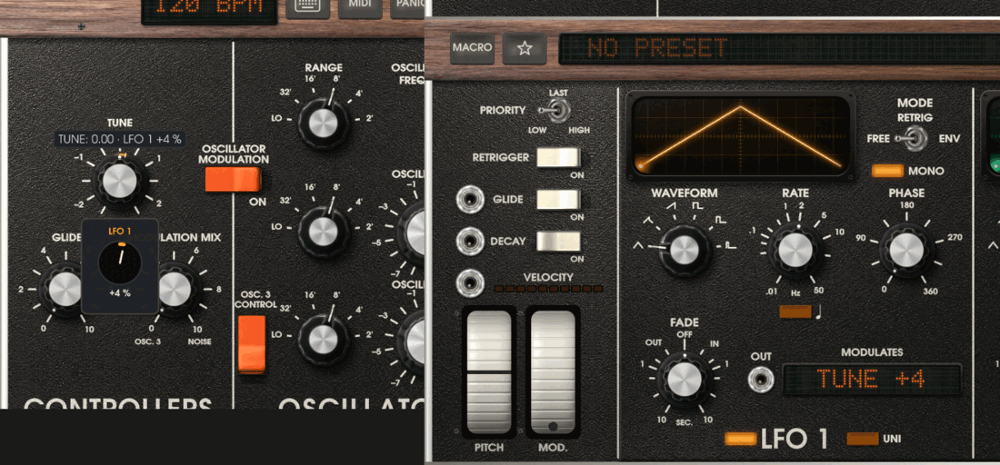

The CA-72 also has four LFOs of its own, which the instrument does not. Press **LFO** on the
rail. To give the whole instrument vibrato:

1. Drag a cord from **LFO 1**'s **OUT** jack and let go on **TUNE**. While you drag, every
   knob that can take it is ringed.
2. The cord starts at 25 % of TUNE's travel, a wide swing. Drag the pop-up's dial over the
   knob down to a few percent, or right-click TUNE, choose LFO 1's **DEPTH…** and type `4`.
3. Set LFO 1's **RATE** (about 5 Hz for vibrato) and **WAVEFORM**. **FADE** turned right
   brings the vibrato in after each note starts.

An LFO moves the panel's continuous knobs (not switches, the wheels or RANGE), up to eight
knobs each; **MODULATES** lists them. To remove one, right-click the knob and choose
**REMOVE** under the LFO. **MACRO**, at the rail's left, swaps the wheels for six macro knobs
whose jacks cord to knobs the same way.

## 6. MONO, POLY and UNISON

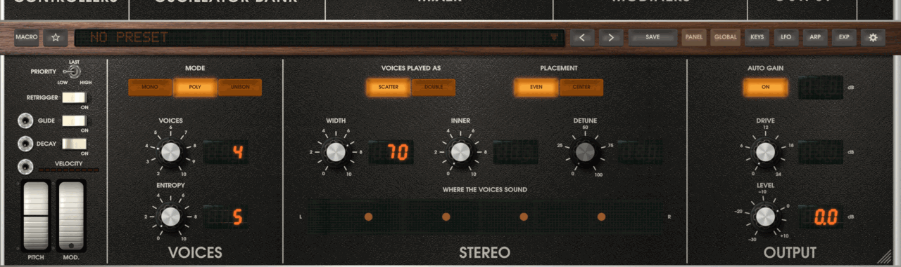

Press **GLOBAL**. **MODE** chooses:

- **MONO:** one note at a time, as the instrument plays (the lowest key held wins: **PRIORITY**
  at the left chooses LOW, LAST or HIGH).
- **POLY:** chords, each note a whole instrument of its own, up to **VOICES** (2 to 10).
- **UNISON:** VOICES whole instruments stacked on every note, turned down to about one voice's
  loudness.

**WIDTH** spreads the voices across the stereo field, **INNER** keeps them off the centre, and
**EVEN** or **CENTER** places them. **DOUBLE** (under VOICES PLAYED AS) gives each note two
voices **DETUNE** apart and doubles their work. Changing MODE, or DOUBLE, releases the notes
sounding. **RETRIGGER** on starts the contours again at every key; with it, choose PRIORITY
**LAST** so that the new note's pitch comes with its attack.

## 7. QUALITY: LO, HI and ULTRA

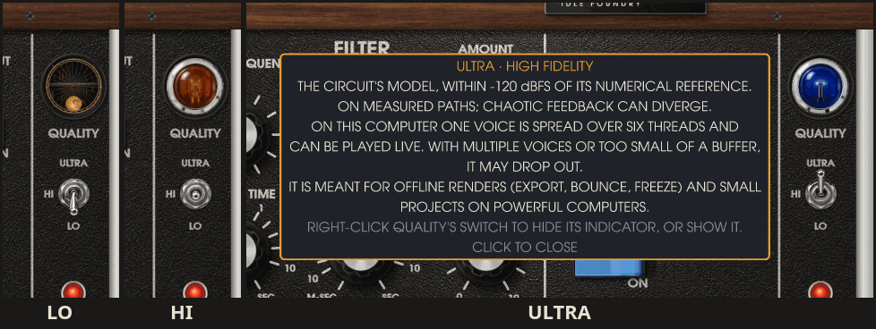

The chrome toggle above POWER sets how the voices are computed:

| | What it is | CPU |
|---|---|---|
| **LO** (the default) | A light model fitted to the circuit; close to it, simpler | Lowest: ten voices cost a quarter to a seventh of HI's |
| **HI** | The circuit's model in real-time quality | Several times LO; FEEDBACK costs much more |
| **ULTRA** | The circuit's model with High Fidelity numerics | Highest: not real-time on most computers; one or two voices come close on six or more fast cores |

Play at **LO** or **HI**; use **ULTRA** to export, bounce or freeze, or for a small project on a
powerful computer. Costs depend on the patch, the voices and the computer: POLY and DOUBLE
multiply them. QUALITY is kept with your project or standalone session, not with presets.
Switching into or out of LO releases held notes.

## 8. Gain headroom: DRIVE, AUTO GAIN and OVERLOAD

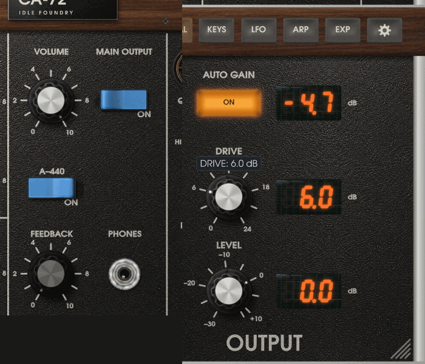

- The panel's **VOLUME** and **MAIN OUTPUT** switch are the instrument's output. GLOBAL's
  **LEVEL** (−30 to +12 dB) is the final gain after them.
- **DRIVE** (0 to 24 dB) pushes the mixer harder into the filter: louder, darker and more
  saturated.
- **AUTO GAIN** (on by default) turns the output down by what DRIVE added; its screen shows how
  much. It measures again when DRIVE or AUTO GAIN changes in the editor, with DRIVE above 0,
  AUTO GAIN on and no notes held. It matches loudness, not peaks.
- **OVERLOAD**, in the mixer, lights for the external input's preamplifier (EXTERNAL INPUT, or
  FEEDBACK), not for the output.

Watch your host's output meter: leave a few decibels below 0 dBFS, more for chords. Ten POLY
voices with WIDTH can peak above 0 dBFS; lower LEVEL or VOLUME.

## 9. Presets: find, save, start again

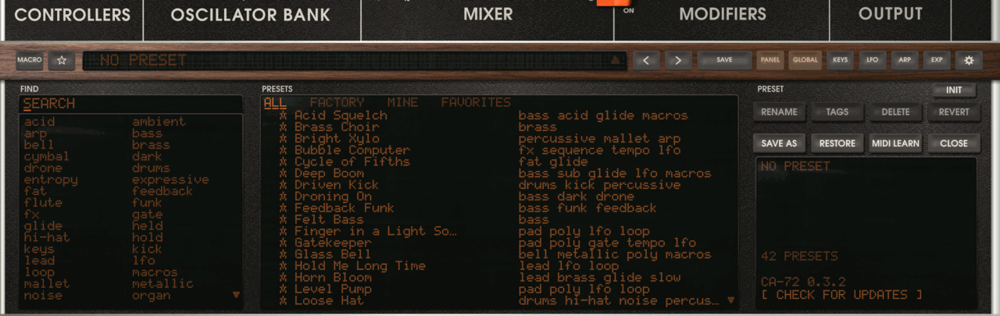

Click the preset's name to open the drawer. **FIND** searches names, descriptions and tags, or
click a tag; **ALL**, **FACTORY**, **MINE** and **FAVORITES** filter the list. Click a preset to
hear it, double-click to choose it and close the drawer. The rail's arrows step through the
list.

**SAVE** (on the rail) or **SAVE AS** (in the drawer): type a name, Tab to the tags, then Enter.
A dot after the name means the sound has changed since it was chosen. Saving under a factory
preset's name keeps yours in its place; **REVERT** brings the factory one back, and **RESTORE**
brings back factory presets you deleted. **INIT** starts from the default sound.

Presets are files in `Idle Foundry/CA-72/Presets` in your user data folder
(`~/Library/Application Support` on macOS, `%APPDATA%` on Windows, `~/.local/share` on
Linux), shared by the standalone and every plug-in format. QUALITY, MIDI assignments and the
MOD WHEEL SOURCE are not in presets.

## 10. MIDI Learn

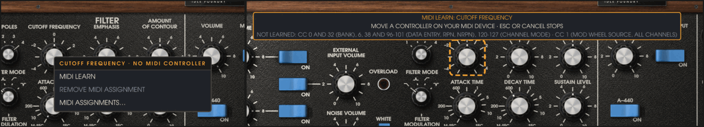

1. Right-click a control and choose **MIDI LEARN**. It is ringed and a note says it is waiting.
2. Move a knob, fader or button on your controller. It is assigned (the note names it, such as
   `CH 1 · CC 74`); its next messages move the control.

Escape or **CANCEL MIDI LEARN** stops waiting. Right-click again for **REMOVE MIDI ASSIGNMENT**,
or **MIDI ASSIGNMENTS…** for the list of every control and its controller. Learning the
MODULATION wheel sets this computer's MOD WHEEL SOURCE instead. Assignments are saved with your
project (or the standalone's session), not with presets. Your host must pass MIDI control
changes to the plug-in.

To type an exact value instead, **Cmd-click** a knob on macOS or **Ctrl-click** on Windows and
Linux, type, and press Enter.

## 11. The standalone's MIDI map mode

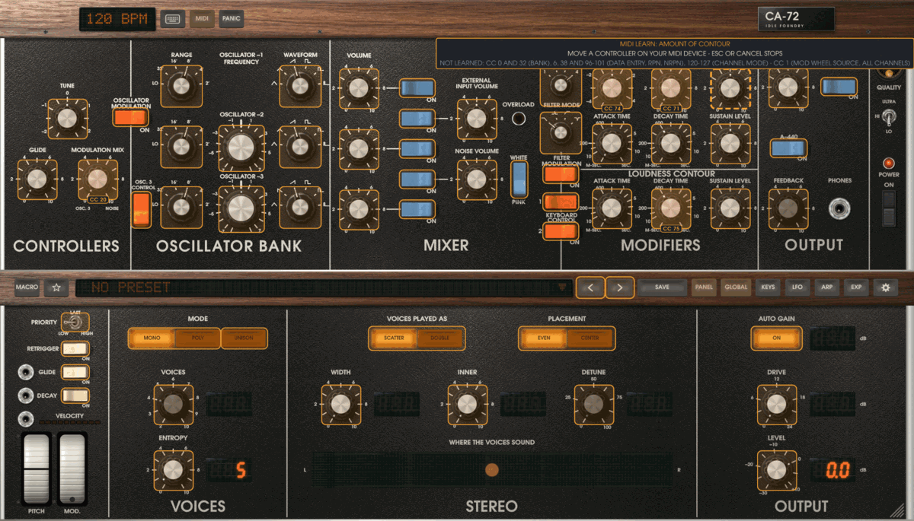

The standalone can map many controls in a row:

1. Press **MIDI** beside the TEMPO screen (between TYPING and PANIC). Every learnable control
   is outlined; learned ones show their controller (`CC 74`).
2. Click a control: it is chosen, not moved, and waits. Move a controller to assign it.
3. Click the next control, and so on. A switch can also take a note: each press of that note
   then flips the switch.
4. Delete or Backspace removes the chosen control's controller. Escape stops waiting; Escape
   again, or **MIDI**, leaves the mode.

The rail's keys still work, so the GLOBAL and LFO pages, the macros and the ARP, EXP and FX
drawers can be mapped too. The plug-ins have no MIDI key: use the right-click menu and the list.

## 12. The ARP and FX drawers

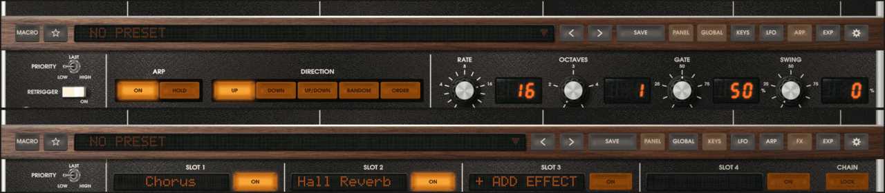

Press **ARP**, switch **ON** and hold a chord. **DIRECTION**, **RATE**, **OCTAVES**, **GATE**
and **SWING** shape the pattern; **HOLD** keeps it going after you let go. Plug-ins follow the
host's tempo; the standalone uses its **TEMPO** screen. Closing the drawer leaves it running.

In the standalone, **FX** drops four slots for your own CLAP and VST3 effects, after the
synth. **+ ADD EFFECT** lists those installed (**SCAN AGAIN** after installing more); click a
name for its window, its **ON** tab to bypass it, or right-click for **REPLACE…** and
**REMOVE**. In a plug-in, use your host's effects.

## Troubleshooting

- **No sound:** choose INIT; check **MAIN OUTPUT** is on, **POWER** is on and **VOLUME** and
  LEVEL are up. Click a key of the on-screen keyboard (**KEYS**): if that sounds, check your
  host's MIDI routing to the track, or the standalone's **AUDIO & MIDI** inputs. A hanging or
  repeating note: check ARP's ON and HOLD; the standalone's **PANIC** releases notes.
- **No vibrato:** go through section 4: oscillator 3 at **LO**, **OSC. 3 CONTROL** off,
  **MODULATION MIX** toward OSC. 3, **OSCILLATOR MODULATION** on, the **MOD. wheel** raised. If
  only the hardware wheel does nothing, check settings' **MOD WHEEL SOURCE**.
- **Crackles or dropouts:** raise the audio buffer size (in your host, or the standalone's
  AUDIO & MIDI); choose **QUALITY LO**; play fewer **VOICES**; turn **DOUBLE** off. **ULTRA** is
  for offline renders. On Linux the standalone needs real-time priority: if a note after PANIC
  says it has none, install `rtkit` or join the `realtime` (or `audio`) group, then log in
  again.
- **High CPU:** QUALITY, VOICES, DOUBLE, UNISON and FEEDBACK set the cost. An instance with no
  note playing costs next to nothing. Freeze or bounce tracks that play at HI or ULTRA.
- **The plug-in is not found:** check the files are in the folders of section 1 (`CA-72.vst3`,
  `CA-72.clap`, and on macOS `CA-72.component`), that your host scans that folder and format,
  and rescan or restart the host. Logic and GarageBand use the Audio Unit only. On Linux,
  check that your host scans `~/.vst3` and `~/.clap` (or `/usr/lib/vst3` and `/usr/lib/clap`
  after `--system`).
- **The panel is too small or too large:** drag the grip at the bottom-right corner, or choose
  **WINDOW › SIZE…** in settings; the size you choose becomes the default for new instances.

More in the README: [Standalone application](../README.md#standalone-application),
[MIDI Learn](../README.md#midi-learn) and [Limitations](../README.md#limitations).
